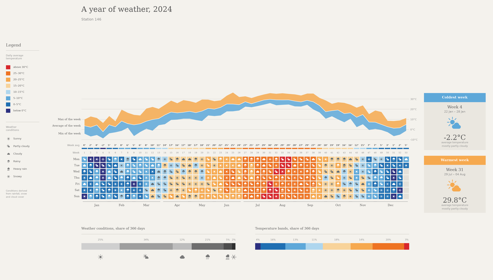

# Weather Visualisation

A Python data visualisation project that turns daily weather observations into a calendar-style infographic. The included example presents 2024 weather for Station 146.

## Weather infographic



[Open the full-size infographic](weather_infographic.png)

Each square represents one day: its colour shows the daily average temperature, and its icon shows the derived weather condition. Columns represent weeks and rows run from Monday to Sunday. The curve above the calendar shows the weekly mean temperature in white, with blue extending to the week's lowest daily minimum and orange extending to its highest daily maximum. The bottom bars summarise how frequently each weather condition and temperature band occurred.

## What can be found from the data?

The included CSV has **366 daily observations**, covering **1 January–31 December 2024**, with no missing or duplicate dates. The findings below were calculated from that CSV; the weekly values and weather categories follow the notebook's definitions.

### Temperature patterns

- **A clear seasonal cycle:** January was the coldest month, averaging **2.2°C**, and August was the warmest, averaging **29.1°C**. The calendar changes from mostly blue in winter to orange and red in summer, then returns to cooler colours towards December.
- **Annual average temperature: 15.8°C**, calculated as the mean of all 366 daily average temperatures.
- **Coldest week: 22–28 January (week 4), averaging −2.2°C. Warmest week: 29 July–4 August (week 31), averaging 29.8°C.** These are the two weeks highlighted in the infographic. Only weeks with at least five observations are eligible for these panels.
- **Daily extremes:** the highest daily maximum was **36.5°C on 19 June**, while the lowest daily minimum was **−8.7°C on 23 January**. The hottest individual day therefore occurred earlier than the warmest week and month.
- **Warm days were more frequent than days with a below-freezing daily average:** **87 days (23.8%)** had a daily average of at least 25°C, including **12 days (3.3%)** at or above 30°C. **13 days (3.6%)** had a daily average below 0°C. These counts refer to daily averages, so they do not count every day with an overnight frost or an afternoon above 30°C.

### Weather conditions and rainfall

- **Partly cloudy was the most common derived condition:** **126 days (34.4%)**, followed by sunny on **91 days (24.9%)**. The other categories were rainy on **76 days (20.8%)**, cloudy on **45 days (12.3%)**, heavy rain on **20 days (5.5%)**, and snowy on **8 days (2.2%)**.
- **Rainy and heavy-rain categories together accounted for 96 days (26.2%).** This is a count of the notebook's categories, not every day with recorded precipitation: rainfall below the classification threshold can receive another label, and snow takes priority when both snow and rain are recorded.
- **Rainfall was concentrated in summer:** June–August contributed **46.3% of the year's recorded rainfall total**, and **July had the largest monthly rainfall total**. This is an additional finding from the CSV; the infographic shows weather categories rather than rainfall amounts. A share is reported here because the repository does not yet document rainfall units.

Together, the graph and data describe a year with cold winter spells, sustained summer warmth, and a substantial summer share of rainfall. These observations describe **one station in one year**; they do not establish a long-term climate trend or explain the causes of the weather patterns. Percentages are rounded and may not sum to exactly 100%.

## What it shows

- A daily calendar coloured by average temperature, with custom weather icons.
- Weekly mean temperatures and weekly minimum/maximum temperatures.
- Coldest and warmest weeks, selected from weeks with at least five observations.
- The share of days in each weather condition and temperature band.

Built with pandas, NumPy and Matplotlib in a Jupyter notebook.

## Repository files

- `Weather_infographic_과제_기상자료 시각화에 사용한 코드를.ipynb` — data loading, classification, icon drawing and infographic generation.
- `weather dataset.csv` — daily weather observations.
- `weather_infographic.png` — exported example infographic.

## Run locally

1. Clone the repository and enter its folder:

   ```sh
   git clone https://github.com/isabelhendrick-sudo/Weather_visualisation.git
   cd Weather_visualisation
   ```

2. Create a virtual environment:

   ```sh
   python -m venv .venv
   ```

   Activate it on Windows PowerShell with `.\.venv\Scripts\Activate.ps1`, or on macOS/Linux with `source .venv/bin/activate`.

3. Install the dependencies:

   ```sh
   python -m pip install numpy pandas matplotlib jupyterlab
   ```

4. Start JupyterLab from the repository folder:

   ```sh
   jupyter lab
   ```

5. Open the notebook. Before running its cells, replace the computer-specific `CSV_PATH` assignment in section 2 with:

   ```python
   CSV_PATH = "weather dataset.csv"
   ```

6. Run all cells in order. The final cell saves `weather_infographic.png` in the notebook working directory, overwriting an existing file of that name.

## Data

The CSV contains these fields:

```text
year, month, day, tmax, tavg, tmin, humid, wind, sunshine, rainfall, snow, cloud
```

The notebook uses the date fields, temperatures (`tmax`, `tavg`, `tmin`), rainfall, snow and cloud cover. Humidity, wind and sunshine are included in the CSV but are not used in the infographic.

Temperatures are displayed in degrees Celsius. The repository does not document the original data provider, station location, or units/scales for the other measurements; those details should be added before interpreting or reusing the data.

## How weather conditions are assigned

Each day receives one condition using the following rules, evaluated in order:

1. `snow > 0`: Snowy.
2. `rainfall >= 20`: Heavy rain.
3. `rainfall >= 1`: Rainy.
4. `cloud >= 7`: Cloudy.
5. `cloud >= 3`: Partly cloudy.
6. Otherwise: Sunny.

These are project-specific classifications derived from the numeric observations, rather than weather condition labels supplied with the dataset.

Temperature colours use boundaries at 0, 5, 10, 15, 20, 25 and 30°C. A value on a boundary enters the higher band; for example, 30°C enters the final band, currently labelled “above 30°C”.

Weeks run Monday–Sunday and are numbered sequentially from the week containing the first observation, rather than using ISO week numbers. The weekly mean is the mean of daily `tavg`; the weekly extremes are the lowest `tmin` and highest `tmax`.

## Customisation and limitations

- Change the title and station subtitle in the final notebook cell for another dataset.
- Edit the colour constants and temperature boundaries in section 1 to adjust the design.
- The layout is designed around a single year. Use one year of daily observations per figure.
- Input validation for missing values, duplicate dates and missing weeks is not currently implemented.
- Dependency versions are not pinned, so the setup above is a starting point rather than a verified reproducible environment.

## Data attribution and licence

No data source attribution or licence is included in the current repository. Add the dataset provider, source link, access date, measurement units and applicable reuse terms. Choose a code licence separately before describing the project as freely reusable.
